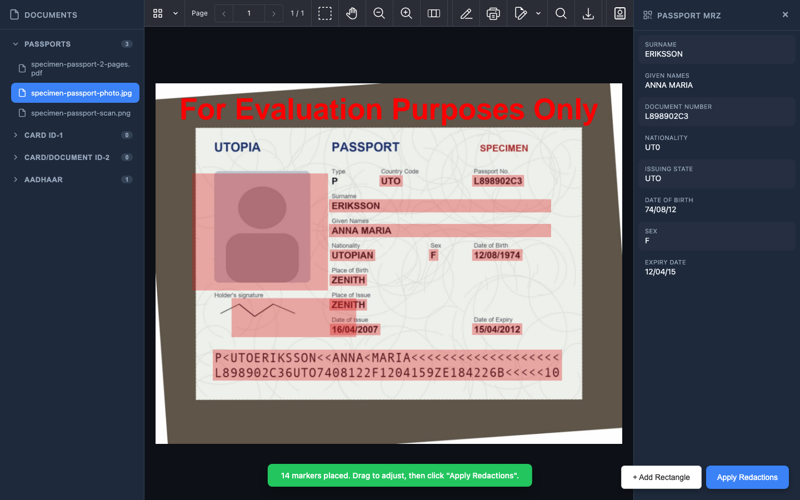
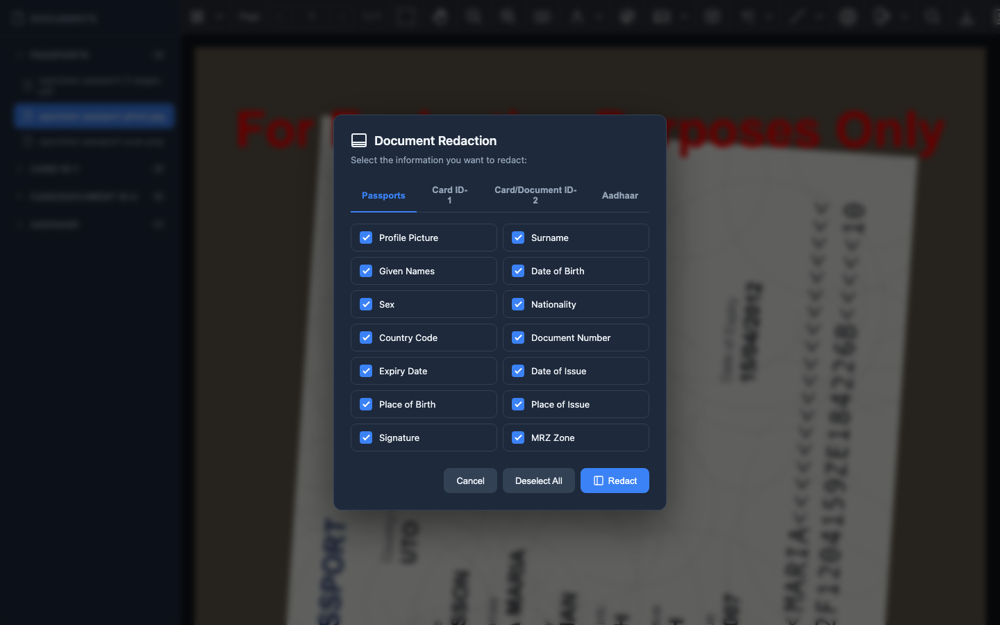
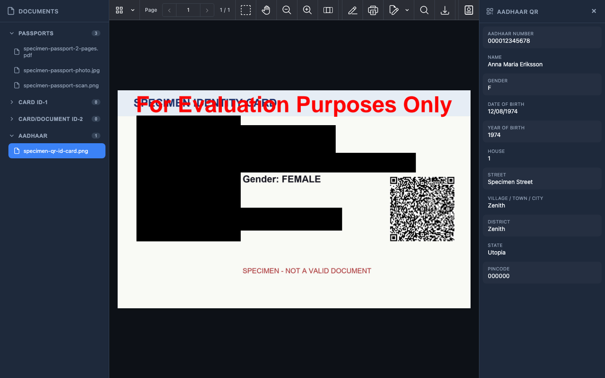

# Nutrient Passport Redaction

A Nutrient.io demo that finds the personal data on passports and QR-coded ID cards with GdPicture.NET (MRZ reading, OCR, QR decoding), places movable redaction markers in the Nutrient Web SDK viewer, and burns the redactions in.



1. **Input.** Images (JPEG, PNG, TIFF, BMP) or PDFs in `input-docs/<category>/`. Images are converted to PDF with GdPicture for display. PDF pages are rendered at 200 DPI.
2. **Upright page.** EXIF rotation is applied, small images are upscaled, the page is deskewed, and the GdPicture MRZ reader (`OCRSpecialContext.MRZ`) is tried at 0, 90, 180 and 270 degrees until a real TD3 MRZ is found. Pages without an MRZ are kept unchanged.
3. **Field location (passports).** A full-page English OCR gives the text lines. Each field is found by its printed label (the value is the line below, or on the same line), names are matched against the MRZ values, and the photo, signature and MRZ come from the MRZ geometry (one MRZ character width as the unit). When a label is not read, an MRZ-relative position is used.
4. **Field location (ID cards with a QR code).** For the Aadhaar card layout, the GdPicture QR reader finds the QR code, the field zones are placed relative to it (QR side as the unit), and the 12-digit number is refined with OCR. The QR payload (legacy XML format, or a best-effort decode of the compressed Secure QR) is shown in the side panel.
5. **Review.** The processed page is loaded in the Nutrient Web SDK with one rectangle per field. Markers can be moved, resized or added.
6. **Apply.** **Apply Redactions** turns the markers into `RedactionAnnotation`s and calls `applyRedactions()` in the viewer, so the covered content is removed from the PDF.

The server also has a one-step endpoint that draws black boxes into the page images with GdPicture and saves a redacted PDF.

## Document categories

| Category | Folder | Status |
|---|---|---|
| Passports (TD3, 2 x 44 MRZ) | `input-docs/td3` | Implemented |
| ID-1 cards (TD1, 3 x 30 MRZ) | `input-docs/td1` | Placeholder: uses the passport geometry |
| ID-2 documents (TD2, 2 x 36 MRZ) | `input-docs/td2` | Placeholder: uses the passport geometry |
| Aadhaar cards (QR code, no MRZ) | `input-docs/aadhaar` | Implemented, QR-anchored |

## Prerequisites

- .NET SDK 8 or later
- Windows, macOS or Linux (GdPicture.API brings the native runtimes for the three)
- A browser with internet access: the Nutrient Web SDK is loaded from `cdn.cloud.pspdfkit.com`
- Python 3 with Pillow, qrcode and reportlab, only to regenerate the samples

The OCR resources (`ocrb.traineddata` for the MRZ, `eng.traineddata` for the page) come from the `GdPicture.Resources` NuGet package and are copied next to the app at build time.

## Environment variables

Start from `.env.example`.

| Variable | Purpose | Default |
|---|---|---|
| `GDPICTURE_LICENSE_KEY` | GdPicture.NET license key | empty = evaluation mode |
| `ASPNETCORE_URLS` | Address the server listens on | `http://localhost:5330` |
| `GdPicture__ResourceFolder` | Folder with the OCR resources | `runtimes/any/native` next to the app |

In evaluation mode GdPicture stamps "For Evaluation Purposes Only" on every page it writes, including the processed page shown in the viewer. The Web SDK has no license key in this demo and also runs in evaluation mode.

## Build and run

```bash
dotnet build
```

```bash
set -a && source .env && set +a && dotnet run
```

Open <http://localhost:5330>.

## Using the app

1. Pick a document in the left sidebar. Documents are grouped by category.
2. Click the passport button at the right end of the viewer toolbar.
3. Choose the fields to redact. The tab follows the document's category.

   

4. Click **Redact**. The processed page opens with one red marker per field, and the side panel shows the MRZ (passports) or the QR payload (ID cards).
5. Move or resize the markers, or click **+ Add Rectangle**, then click **Apply Redactions**.

   

Screenshots were taken in evaluation mode with the generated samples.

## Samples

All documents in `input-docs` are fictitious and generated by `tools/make_samples.py`:

| File | Content |
|---|---|
| `td3/specimen-passport-scan.png` | Passport data page, flat scan, ICAO 9303 specimen data (state "Utopia", code UTO) |
| `td3/specimen-passport-photo.jpg` | The same page photographed on a desk, turned a quarter turn |
| `td3/specimen-passport-2-pages.pdf` | A visa page without MRZ, then the data page |
| `aadhaar/specimen-qr-id-card.png` | ID card front in the Aadhaar layout, QR code with fictitious XML data, invalid number |

```bash
python3 tools/make_samples.py input-docs
```

The script uses the macOS Andale Mono (MRZ) and Arial fonts. On other systems, set `SPECIMEN_FONT_DIR` to a folder with the same `.ttf` files. Add your own documents to the category folders; they show up after a page reload.

## API

| Method and path | Description |
|---|---|
| `GET /api/documents` | Documents grouped by category: `{ td1, td2, td3, aadhaar }`, each a list of `{ name, category, url }` |
| `GET /api/documents/pdf/{category}/{filename}` | The document as PDF (images are converted on the fly) |
| `POST /api/redaction/preview` | Body `{ fileName, docType, fields }`. Returns `{ success, message, previewDocumentUrl, redactions, mrzData, qrFormat, qrData }`; `redactions` are rectangles in PDF points (top-left origin) on the processed PDF |
| `POST /api/redaction/redact` | Same body. Draws black boxes with GdPicture and returns `{ success, message, redactedFileName, mrzData }` |
| `GET /output-docs/{file}` | Processed and redacted PDFs |

Field names: `photo`, `surname`, `givenNames`, `dateOfBirth`, `sex`, `nationality`, `countryCode`, `documentNumber`, `expiryDate`, `dateOfIssue`, `placeOfBirth`, `placeOfIssue`, `signature`, `mrz`. ID cards with a QR code use `photo`, `givenNames`, `dateOfBirth`, `sex` and `documentNumber`.

## Known limits

- The MRZ check accepts TD3 passports only (first line starting with `P`). TD1 and TD2 have no geometry of their own yet.
- Field positions are tuned for a typical TD3 data page and for the standard Aadhaar card front. Other layouts may need new offsets; the markers can always be adjusted by hand.
- Generated outputs accumulate in `output-docs/`.

## Project layout

| Path | Content |
|---|---|
| `Program.cs` | Web API (ASP.NET Core minimal API), GdPicture license registration |
| `Services/PassportRedactionService.cs` | MRZ and QR detection, OCR, field geometry, GdPicture redaction |
| `Models/RedactionModels.cs` | Request and response models |
| `wwwroot` | Web interface with the Nutrient Web SDK viewer |
| `tools/make_samples.py` | Sample generator |
| `input-docs` | Sample documents, one folder per category |
